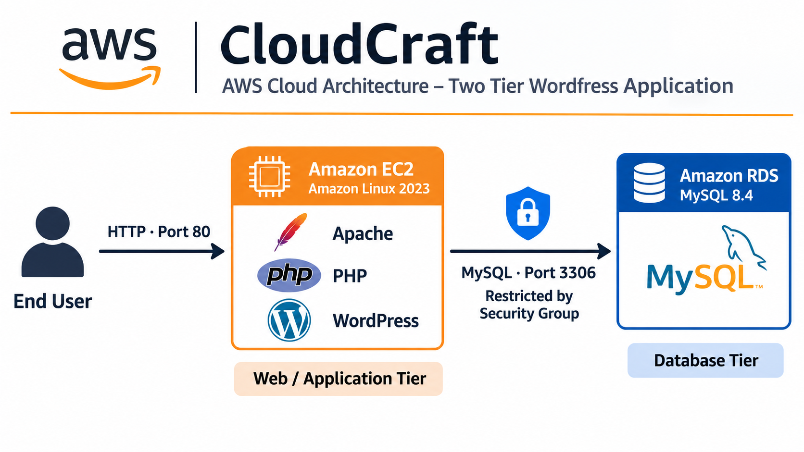
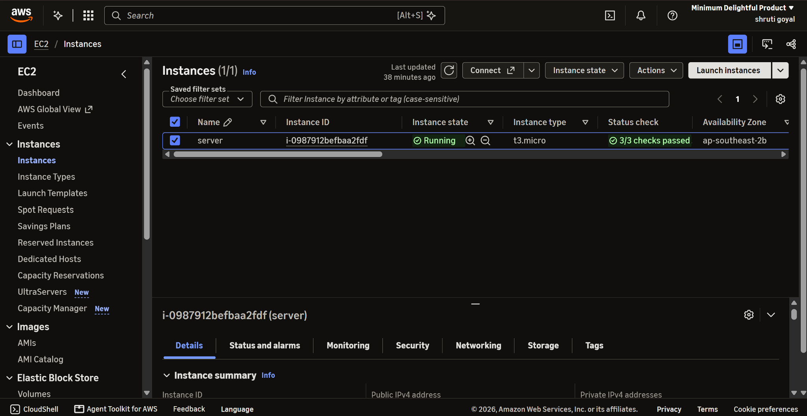
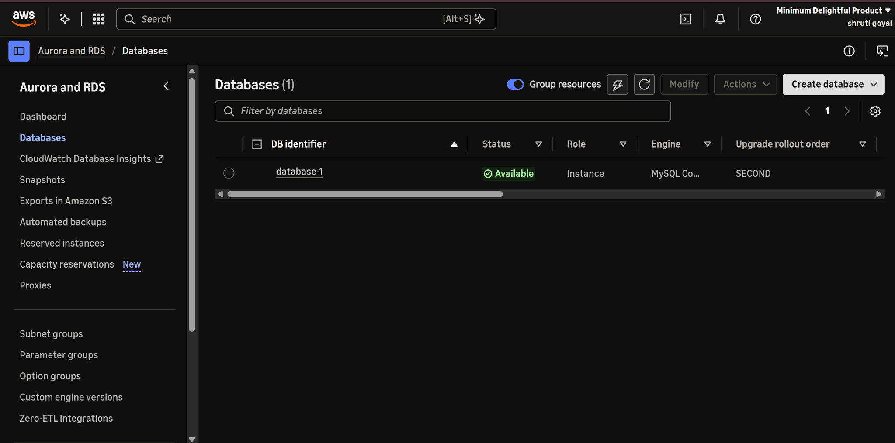
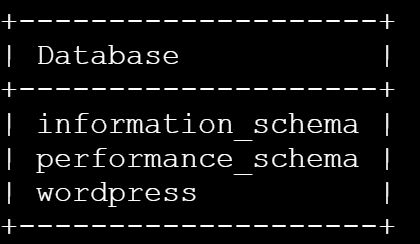
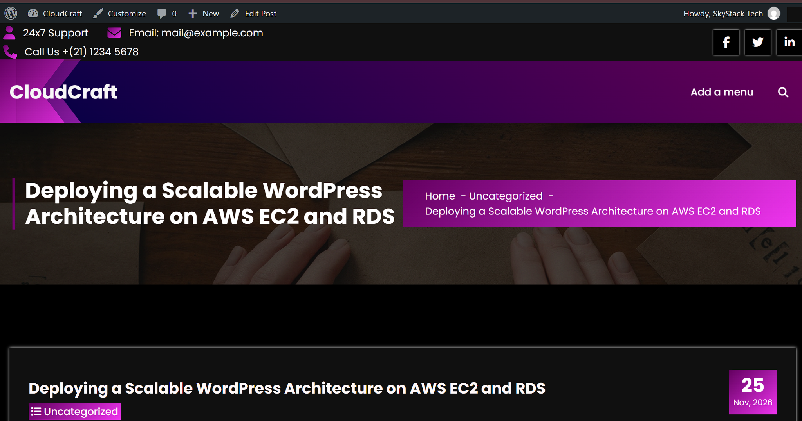

# ☁️ CloudCraft – Two-Tier WordPress Architecture on AWS

<p align="center">
  
</p>

<p align="center">
  <b>A Two-Tier WordPress Application Deployed on Amazon Web Services</b>
</p>

<p align="center">
  
  
  
  
  
</p>

---

## 📌 Project Overview

**CloudCraft** is a two-tier WordPress web application deployed on Amazon Web Services (AWS).

The project demonstrates how to deploy and configure a WordPress website using Amazon EC2 as the web/application server and Amazon RDS as the managed database service.

The application tier runs on Amazon Linux 2023 with Apache, PHP, and WordPress, while the database tier uses Amazon RDS with MySQL 8.4.

The EC2 instance processes incoming HTTP requests and communicates with the RDS database through a secure network connection.

This project focuses on practical cloud computing, Linux administration, database management, AWS networking, and application troubleshooting.

## 🏗️ AWS Architecture

The project follows a two-tier architecture:

**End User → Amazon EC2 → Amazon RDS**

### Architecture Components

| Tier | AWS Service | Components |
|---|---|---|
| Web/Application Tier | Amazon EC2 | Amazon Linux 2023, Apache, PHP, WordPress |
| Database Tier | Amazon RDS | MySQL 8.4 |

### Request Flow

1. A user accesses the WordPress website through a browser.
2. The request reaches the Amazon EC2 instance over HTTP.
3. Apache processes the request using PHP and WordPress.
4. WordPress communicates with Amazon RDS over MySQL port 3306.
5. The database returns the required information to the application.

## 🛠️ Technology Stack

| Technology | Purpose |
|---|---|
| Amazon Web Services | Cloud infrastructure |
| Amazon EC2 | Application hosting |
| Amazon Linux 2023 | Operating system |
| Apache HTTP Server | Web server |
| PHP | Application runtime |
| WordPress | Content Management System |
| Amazon RDS | Managed database service |
| MySQL 8.4 | Relational database |
| AWS Security Groups | Network access control |

## 🎯 Project Objectives

- Deploy a WordPress website on Amazon EC2.
- Configure Apache and PHP.
- Create and configure an Amazon RDS MySQL database.
- Establish secure EC2-to-RDS connectivity.
- Configure WordPress database settings.
- Understand AWS networking and security groups.
- Practice Linux administration and SQL commands.
- Troubleshoot application and database connectivity issues.

---

## 🚀 Deployment Guide

### Step 1: Launch an EC2 Instance

1. Open the AWS Management Console.
2. Navigate to Amazon EC2.
3. Launch an instance using Amazon Linux 2023.
4. Select an appropriate instance type.
5. Configure the security group.

**Suggested inbound rules:**

| Type | Port | Source |
|---|---|---|
| SSH | 22 | Trusted administrator IP |
| HTTP | 80 | 0.0.0.0/0 |

### Step 2: Update Packages and Install Required Software

Connect to the EC2 instance and execute:

```bash
sudo dnf update -y

sudo dnf install -y httpd php php-mysqlnd php-fpm mariadb105
```

Verify the installations:

```bash
httpd -v
php -v
mysql --version
```

### Step 3: Start Apache and PHP-FPM

```bash
sudo systemctl enable --now httpd

sudo systemctl enable --now php-fpm
```

Check service status:

```bash
sudo systemctl status httpd

sudo systemctl status php-fpm
```

### Step 4: Create an Amazon RDS Database

1. Open Amazon RDS in the AWS Console.
2. Select Create Database.
3. Choose MySQL as the database engine.
4. Select MySQL 8.4.
5. Configure the DB identifier and credentials.
6. Configure the VPC and DB subnet group.
7. Wait until the database status becomes Available.
8. Copy the RDS endpoint for application configuration.

**Important:** Keep database credentials and sensitive endpoints private.

### Step 5: Configure RDS Security Group

Add the following inbound rule to the RDS security group:

| Type | Port | Source |
|---|---|---|
| MySQL/Aurora | 3306 | EC2 Security Group |

Allow database traffic only from the EC2 application server security group.

Do not expose MySQL port 3306 publicly.

### Step 6: Connect to RDS and Create Database

Connect from the EC2 instance:

```bash
mysql -h YOUR_RDS_ENDPOINT -P 3306 -u MASTER_USERNAME -p
```

Create the WordPress database:

```sql
CREATE DATABASE wordpress;

CREATE USER 'wpuser'@'%'
IDENTIFIED BY 'YOUR_STRONG_PASSWORD';

GRANT ALL PRIVILEGES ON wordpress.*
TO 'wpuser'@'%';

SHOW DATABASES;

USE wordpress;

SELECT DATABASE();

EXIT;
```

Replace all placeholders with your own values.

### Step 7: Download and Install WordPress

```bash
cd /var/www/html

sudo wget https://wordpress.org/latest.tar.gz

sudo tar -xzf latest.tar.gz

sudo cp -a wordpress/. /var/www/html/

sudo rm -rf wordpress latest.tar.gz
```

### Step 8: Configure WordPress Database Connection

Create the configuration file:

```bash
cd /var/www/html

sudo cp wp-config-sample.php wp-config.php

sudo nano wp-config.php
```

Configure the database settings:

```php
define('DB_NAME', 'wordpress');

define('DB_USER', 'wpuser');

define('DB_PASSWORD', 'YOUR_STRONG_PASSWORD');

define('DB_HOST', 'YOUR_RDS_ENDPOINT:3306');

define('DB_CHARSET', 'utf8mb4');

define('DB_COLLATE', '');
```

Replace the placeholders with your actual database configuration.

**Never upload wp-config.php or real credentials to GitHub.**

### Step 9: Configure Permissions and Restart Services

```bash
sudo chown -R apache:apache /var/www/html

sudo find /var/www/html -type d -exec chmod 755 {} \;

sudo find /var/www/html -type f -exec chmod 644 {} \;

sudo chmod 640 /var/www/html/wp-config.php

sudo systemctl restart php-fpm

sudo systemctl restart httpd
```

### Step 10: Access the WordPress Website

Open the following address in your browser:

```text
http://YOUR_EC2_PUBLIC_IP
```

Complete the WordPress installation wizard and configure the website title as **CloudCraft**.

For production deployments, configure HTTPS.

---

## 📸 Project Screenshots

The following screenshots demonstrate the AWS infrastructure, database configuration, terminal output, and deployed WordPress website.

### 1. AWS Architecture


### 2. AWS EC2 Console



### 3. Amazon RDS Database Console



### 4. Database Terminal



### 5. Live WordPress Website



---

## 🔧 Troubleshooting & Challenges

During the implementation, I explored and resolved several common configuration issues.

### 1. Amazon Linux 2023 Package Management

Amazon Linux 2023 uses `dnf` for package management.

```bash
sudo dnf update -y

sudo dnf install -y httpd php php-mysqlnd php-fpm mariadb105
```

### 2. MySQL Error 1045 – Access Denied

Possible causes:

- Incorrect database username or password.
- Incorrect RDS endpoint.
- Missing database privileges.
- Database security group configuration issues.

Verify the connection:

```bash
mysql -h YOUR_RDS_ENDPOINT -P 3306 -u wpuser -p
```

### 3. MySQL Error 1396 – CREATE USER Failed

This error can occur when the database user already exists.

Check existing users:

```sql
SELECT user, host
FROM mysql.user
WHERE user = 'wpuser';
```

If the account already exists, update its password if authorized:

```sql
ALTER USER 'wpuser'@'%'
IDENTIFIED BY 'YOUR_STRONG_PASSWORD';
```

### 4. PHP HTTP 500 Error

A PHP syntax error in `wp-config.php` can cause an HTTP 500 error.

Check PHP syntax:

```bash
php -l /var/www/html/wp-config.php
```

Check service logs:

```bash
sudo journalctl -u php-fpm -n 100 --no-pager

sudo tail -n 100 /var/log/httpd/error_log
```

Correct the configuration and restart services:

```bash
sudo systemctl restart php-fpm

sudo systemctl restart httpd
```

**Key Learning:** Checking application syntax and service logs helps identify configuration issues without unnecessarily rebuilding cloud infrastructure.

---

## 🔐 Security Best Practices

- Restrict SSH access to trusted IP addresses.
- Keep the RDS database private.
- Allow MySQL traffic only from the EC2 security group.
- Never upload AWS credentials or private keys to GitHub.
- Keep `wp-config.php` and sensitive configuration files out of public repositories.
- Use strong and unique database passwords.
- Follow the principle of least privilege.
- Keep the operating system and WordPress updated.
- Use HTTPS for production deployments.
- Regularly review AWS permissions and security groups.

## 💰 Cost Optimization

After testing the CloudCraft application and verifying EC2-to-RDS connectivity, the EC2 instances were terminated to reduce ongoing compute costs.

Unused AWS resources should also be reviewed, including:

- EBS Volumes
- Snapshots
- Elastic IP Addresses
- Amazon RDS Instances

**Note:** Terminating EC2 instances does not automatically remove all associated resources. Amazon RDS and retained storage may continue to incur charges.

## 📚 Key Learning Outcomes

Through this hands-on project, I gained practical experience in:

- AWS EC2 provisioning and management.
- Amazon Linux 2023 administration.
- Apache and PHP configuration.
- WordPress deployment.
- Amazon RDS MySQL database management.
- SQL database and user administration.
- AWS Security Group configuration.
- EC2-to-RDS connectivity.
- Linux and application troubleshooting.
- Cloud security and cost optimization.

---

## 👩‍💻 Author

**Shruti Goyal**

Cloud & DevOps Enthusiast

**Project:** CloudCraft – Two-Tier WordPress Architecture on AWS

**GitHub:** [shrutigoyal7100-cell](https://github.com/shrutigoyal7100-cell)

---

<p align="center">
  <b>Built with AWS, Linux, Apache, PHP, MySQL & WordPress.</b>
  <br><br>
  Learning Cloud Computing & DevOps Through Hands-On Projects.
</p>
